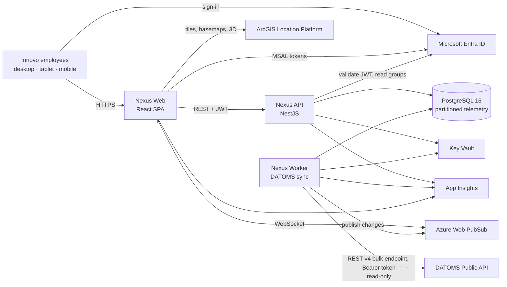

# 03 · Architecture

**Style:** a modular monolith in a TypeScript monorepo. There are three deployable apps (web, api, worker) and one PostgreSQL 16 database (native partitioning + Nexus rollup tables). It runs on Azure UAE North.

**Why:** two developers today, one data source, and fewer than 500 users. The fewest moving parts wins. Every module owns its own tables and talks to other modules only through their service interfaces, so any module can become its own service later without a rewrite. Decision record: `adr/0001-modular-monolith.md`.

## 1. System context


Key rules shown by the diagram:
- **Only the worker talks to DATOMS.** The API and the browser never call DATOMS. Telemetry, status, location, alerts and site data come **only** from the bulk endpoint (ADR 0010).
- **Users read only from Nexus's own database.** So 5 users and 5,000 users cause the same DATOMS traffic.
- **The browser gets live changes from Web PubSub**, not by polling DATOMS.

## 2. Containers (deployables)
| App | Tech | Hosting | Scales by | Notes |
|---|---|---|---|---|
| `apps/web` | React 19 + Vite + TypeScript, ArcGIS Maps SDK for JS | Azure Static Web Apps (or Container App with nginx if private networking is required) | CDN, no servers | Static files only. No secrets except public client IDs. |
| `apps/api` | NestJS 11 (Fastify) on Node 22 LTS | Azure Container Apps | 1→N replicas on HTTP load | Stateless. Any replica can serve any request. |
| `apps/worker` | NestJS standalone application, same codebase | Azure Container Apps (min 1, max 1 for the poller) | Leader lock; split jobs later | The only DATOMS caller. Scheduled jobs plus a job runner. |
| Database | Azure Database for PostgreSQL Flexible Server 16 | Managed, zone-redundant HA in prod | Vertical first, then read replica | Schemas: `core`, `access`, `telemetry`, `events`, `integration`, `audit` (see `06-database.md`) |
| Live push | Azure Web PubSub | Managed | Units | One hub `nexus`, one group per project. Slim messages; joins are done on the server after a scope check (ADR 0008). |
| Files (later) | Azure Blob Storage | Managed | — | Private. Short-lived SAS links only. |

## 3. Modules inside the API and worker
Each module has its own folder, its own tables (schema prefix or table list in `06-database.md`) and its own permission keys.

| Module | Owns | Phase |
|---|---|---|
| `access` | users, roles, group mappings, project access, permission checks | 1 |
| `audit` | audit log | 1 |
| `portfolio` | organisations, projects/sites, districts, project state | 1 |
| `spatial` | buildings, levels, zones, coordinates (BIM-ready) | 1 (tables), 3 (features) |
| `assets` | assets, asset types, nameplate info, source links | 1 |
| `telemetry` | parameter dictionary, latest packets, raw packets, rollups, status and location history | 1 |
| `energy` | energy views over assets and telemetry (no data of its own) | 1 |
| `equipment` | equipment views and counts (no data of its own) | 1 |
| `events` | DATOMS alerts and notifications, per-user read state | 1 |
| `integrations` | connectors, sync runs, linking to-do, health, rate and credit budget | 1 |
| `live` | Web PubSub tokens and publishing | 1 |
| `admin` | admin endpoints that combine the above (projects, settings, feature flags) | 1 |
| `materials`, `manpower`, `media`, `weather`, `bim`, `reporting` | future | 2+ |

**Module rules:**
- A module may read another module's data only through that module's exported service, never by querying its tables directly. The one exception is read-only SQL views made for that purpose.
- No circular imports. `energy` and `equipment` depend on `assets` and `telemetry`, never the other way round.
- Shared types live in `packages/shared`.

## 4. Data flows

### 4.1 Catalogue sync (hourly, and on worker start)
```mermaid
sequenceDiagram
  participant W as Worker (catalogue job)
  participant C as datoms-client
  participant D as DATOMS API
  participant DB as PostgreSQL
  W->>C: listAllAssets()
  loop each page (limit 1000)
    C->>D: GET /assets?page=n&limit=1000
    D-->>C: assets page
  end
  C-->>W: SourceAsset[] (Nexus types)
  W->>DB: upsert assets (names, nameplate) by (source_system, external_id)
  Note over W,DB: sites, asset types and parameter keys come from the bulk rows in the live poll (ADR 0010)
  W->>DB: if the walk was complete: retire assets missed in 2 complete walks (never delete; stop if > 5%)
  W->>DB: new unmatched items → integration.link_todo
  W->>DB: insert integration.sync_run (counts, duration, errors)
```

### 4.2 Live poll (every 60 s by default; per asset type, ADR 0006)
```mermaid
sequenceDiagram
  participant W as Worker (poll job, leader only)
  participant B as Budget tracker
  participant C as datoms-client
  participant D as DATOMS API
  participant DB as PostgreSQL
  participant P as Web PubSub
  W->>W: which assets are due? (per-type interval; env subset, ADR 0005)
  W->>B: can spend credits (× budget.max_share)?
  B-->>W: yes / wait
  loop fleet pages of 500 (all due) or id-mode chunks of 500 (some due)
    C->>D: POST /assets/telemetry/latest/query
    D-->>C: rows (asset_id, success, data.time, parameters, + status/location/alerts when present)
    Note over C: 422 → halve page and resume<br/>429 → wait Retry-After<br/>5xx → backoff + jitter
  end
  W->>DB: for each row: skip if data.time ≤ stored time
  W->>DB: upsert telemetry.latest_packet (only if newer time)
  W->>DB: insert telemetry.packet (one row per asset packet, daily partition)
  W->>DB: on change only: asset status / location; insert new alerts into events.event
  W->>P: publish slim messages to group project:{id} (status/location changes, summary, values hint)
  W->>DB: insert integration.sync_run
```
Rollups are built separately, once per closed 5-minute bucket, by SQL (ADR 0007).

### 4.3 User reads a screen
```mermaid
sequenceDiagram
  participant B as Browser
  participant A as API
  participant DB as PostgreSQL
  participant P as Web PubSub
  B->>A: GET /v1/projects/{projectId}/equipment/summary (Bearer Entra JWT)
  A->>A: validate JWT → load user, roles, project scope (5-min cache)
  A->>A: guard: permission 'project.read' and projectId in scope (else 404)
  A->>DB: read latest_packet + rollups
  A-->>B: JSON
  B->>A: POST /v1/live/token
  A-->>B: Web PubSub URL (identifies the user, no group-join rights)
  B->>P: connect (gets connectionId)
  B->>A: POST /v1/live/subscriptions {connectionId, projectIds}
  A->>A: permission + scope check per project (out-of-scope ids dropped)
  A->>P: add connection to project:{projectId} (server side)
  P-->>B: slim changes pushed every poll; panels refetch values from the API
```

### 4.4 Failure behaviour
| Failure | What happens |
|---|---|
| DATOMS down or 5xx | The worker backs off and retries. Screens keep showing the last values with their timestamps. The health page turns red after 5 min. An App Insights alert fires. |
| DATOMS 429 or limit near | The budget tracker slows polling (every interval × 2, then × 5; 60 s → 120 s → 300 s by default) and logs a warning. It never breaks the limits. |
| Worker crash | Container Apps restarts it. The leader lock is released when the session ends. On the next poll, time-based dedupe stops duplicates. Rollups have no in-memory state; any missed closed buckets are refreshed on start. |
| Access removed by an admin | The API closes the affected live connections. Clients reconnect and re-subscribe through the scope check (ADR 0008). |
| Database failover | Zone-redundant HA (prod). Apps reconnect through the pool with retry. |
| Web PubSub down | The browser falls back to polling the Nexus API every 60 s. |
| Entra down | Already signed-in users keep working until their tokens expire. Nothing else can be done about it. |

## 5. Connector pattern (for future data sources)
```
packages/connectors/
  core/          → SourceConnector interface + shared types (SourceSite, SourceAsset, SourceReading, SourceEvent)
  datoms/        → DATOMS implementation (wraps packages/datoms-client)
  <future>/      → e.g. hse-system, materials, weather
```
```ts
interface SourceConnector {
  readonly sourceSystem: string;                  // 'datoms'
  listSites(): AsyncIterable<SourceSite>;
  listAssets(): AsyncIterable<SourceAsset>;
  // batches; a reading carries values plus status, location, kind and alerts when the source has them
  pollLatest(scope?: { externalIds?: string[] }): AsyncIterable<SourceReading[]>;
  listEvents?(since: Date): AsyncIterable<SourceEvent>;          // other sources only; DATOMS alerts come in pollLatest (ADR 0010)
  fetchHistory?(assetId: string, from: Date, to: Date): AsyncIterable<SourceReading>;  // DATOMS: on hold (ADR 0010)
}
```
The worker runs each registered connector on its own schedule, and every connector writes to the same tables. Adding a source adds a package and a schedule. The screens do not change.

## 6. Environments and deployment
Two cloud environments only (ADR 0008):

| Env | Purpose | Data | Deploy |
|---|---|---|---|
| local | developer machines | fixtures (recorded DATOMS responses), docker-compose PostgreSQL 16 | `pnpm dev` |
| dev | shared integration | fixtures, or a small id-mode subset of live DATOMS with a small `budget.max_share` (ADR 0005); a DATOMS test org if provided (Q7, Q10). The provisional test key (until 10 Nov 2026) is only in developers' local `.env`, so cloud dev stays on fixtures for now (`07` §3.1) | automatic on merge to `main` |
| prod | all users, and the pilot (S9: only pilot users are assigned to the Entra app) | live DATOMS, full fleet; the only environment that polls the full fleet | manual approval |

- All infrastructure is defined in Bicep (`infra/`). The same templates are used for every environment, with different parameter files (`dev`, `prod`).
- Deferred until there is a decision: Azure Front Door + WAF (Q20) and the Blob/Parquet archive (Q15).
- Private networking in prod: the API and worker run in a VNet-integrated Container Apps environment, and Postgres and Key Vault use private endpoints.
- Managed identities for app → Key Vault and app → Postgres (Entra auth for Postgres where possible).

## 7. Cross-cutting
- **Config:** env vars validated at start-up (zod). Secrets are read from Key Vault through the managed identity.
- **Logging:** pino JSON logs → App Insights. Every request and DATOMS call has a correlation ID.
- **Errors:** RFC 7807 problem+json from the API. Users never see stack traces.
- **Time:** everything is stored in UTC (`timestamptz`). Display uses Asia/Dubai.
- **IDs:** internal `uuid` (v7 where available). External IDs are kept as text in `external_id`.
- **Feature flags:** the `core.feature_flag` table, readable through `/v1/config`, controls the future slots.
