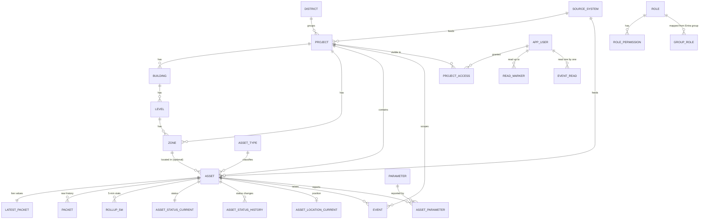

# 06 · Database design

- **Reference SQL:** `db/schema.sql`. It was tested on PostgreSQL 16 and runs as-is on Azure Database for PostgreSQL Flexible Server 16 and on on-premise PostgreSQL 16.
- **Migrations:** `db/migrations/NNNN_name.sql` (node-pg-migrate, with up and down). The schema file and the migrations must always describe the same state.
- **Why no TimescaleDB:** see `adr/0003-database-time-series.md` (amended by `adr/0007-sql-rollups-per-closed-bucket.md`).

## 1. Schemas and ownership
| Schema | Tables | Owned by module |
|---|---|---|
| `core` | `setting`, `feature_flag`, `source_system`, `district`, `project`, `building`, `level`, `zone`, `asset_type`, `asset`; views `v_asset_live`, `v_project_asset_counts` (equipment only), `v_site_metric_live` | portfolio, spatial, assets, config |
| `access` | `app_user`, `role`, `permission`, `role_permission`, `group_role`, `user_role`, `project_access`; functions `user_roles()`, `user_project_ids()` | access |
| `telemetry` | `parameter`, `asset_parameter`, `latest_packet`, `packet`, `rollup_5m`, `rollup_1h`, `rollup_1d`, `status_map`, `asset_status_current`, `asset_status_history`, `asset_location_current`, `asset_location_history` | telemetry |
| `events` | `event`, `event_read`, `read_marker` | events |
| `integration` | `sync_run`, `api_call`, `link_todo`, `cursor` | integrations |
| `audit` | `log` | audit |

## 2. Entity relationships


## 3. Key design decisions
1. **Source identity.** Every synced row has `source_system` and `external_id` (unique together). The DATOMS asset id `"36390"` is stored as text in `external_id`. Internal ids are `uuid`. This lets Nexus add a second data platform without collisions.
2. **Never delete synced rows.** A project or asset that DATOMS no longer returns gets `retired_at = now()`. Its history stays readable.
3. **One row per packet, not one row per parameter.** DATOMS sends about 103 parameters per asset per minute. Storing them as one `jsonb` object per packet keeps row counts about 100× lower and stores any new parameter with no schema change. `lz4` compression is set on the jsonb columns, and new partitions inherit it.
4. **Values exactly as reported.** `values` holds the source's keys and values unchanged. Display names and units come from `telemetry.parameter`, filled from the source. Admins may fill a gap only where the source gives nothing.
5. **Status as reported.** `asset_status_current.source_value` stores the DATOMS label exactly. `telemetry.status_map` translates labels to the four display colours (running, idle, maintenance, off). This is a lookup table of DATOMS's own labels; Nexus never works out a status from values. An unmapped label shows as `unknown` and creates a `link_todo` row of type `status_value` for an admin.
6. **Daily partitions** for `packet` and `api_call`; **monthly** for `rollup_5m`, `rollup_1h`, status and location histories, events, `event_read` and audit. `rollup_1d` is not partitioned (small, kept forever). Dropping a partition is instant retention, with no slow `DELETE`.
7. **Rollups instead of continuous aggregates (ADR 0007).** The `refresh_rollup_5m()` and `refresh_rollup_combine()` functions are safe to run again for any time window. In phase 1 they are the **only** rollup path. The worker runs `refresh_rollup_5m` **once per closed 5-minute bucket**, `rollup.close_grace_intervals` (2) poll intervals after the bucket ends, and again only for closed buckets that receive late packets. It never runs over a sliding window or every minute. Daily buckets are **local days in Asia/Dubai**. Each rollup row stores `packets`, the number of samples Nexus stored, which the API reports as data coverage.
8. **BIM-ready spatial model.** `building → level → zone`, with nullable `building_id / level_id / zone_id` on `core.asset` and `events.event`, and `bim_ref` jsonb for IFC GUIDs, APS URNs or ArcGIS I3S layer ids. `building`, `level` and `zone` each have nullable `source_system` + `external_id` (unique together) and `retired_at`, so a BIM model or another platform can feed them later with the same identity and never-delete rules as assets.
9. **Access is data.** Entra groups map to roles in `group_role`. Project scope sits in `project_access` (per user or per group). Roles with `all_projects = true` (admin, leadership) skip the project filter.
10. **Asset kind (ADR 0009).** `core.asset.kind` is `physical` for physical sensored items of any category (including DGs, solar and mains) or `site_metric` for site-level values as the source reports them, such as energy site totals. **Every equipment list, count, map layer and view filters `kind = 'physical'`.** `v_asset_live` and `v_project_asset_counts` already do. Site-level values are read through `v_site_metric_live`.
11. **Read state that doesn't grow with users × events.** "Mark all read" moves one row in `events.read_marker` (per user, either global or per project). `events.event_read` holds only events read one by one after the marker. It is partitioned by `occurred_at` like `events.event` and dropped with it. Unread = events in scope with `occurred_at` later than the user's latest applicable marker and no `event_read` row.
12. **Parameter dictionary per source type (ADR 0011).** `telemetry.parameter` is unique on `(source_system, source_type_name, key)`, not on the key alone, because the same DATOMS key has different names (and unit spellings) in different categories: 31 keys are shared across DG Set, Fuel Tank, AC Sub-Meter and Solar Inverter (`docs/source/datoms-parameters.md`). `source_type_name` is the category exactly as the source names it, the same string as `core.asset.source_type_name`; `NULL` means the type is not known yet (the constraint is `NULLS NOT DISTINCT`). It is a raw source string, not an FK to `core.asset_type`, so a Nexus type remap never changes a source name. Look up an asset's names with `source_type_name IS NOT DISTINCT FROM asset.source_type_name`; with no row, show the raw key and no unit, and never borrow another type's name. The DATOMS list of 12 Oct 2026 is loaded by `db/seeds/datoms-parameters.sql`, which also appends the four category names to `core.asset_type.source_names` (DG Set → `diesel_generator`, Fuel Tank → `fuel_tank`, AC Sub-Meter → `mains`, Solar Inverter → `solar`).

## 4. Write paths (worker)
| Job | Writes | Rule |
|---|---|---|
| Catalogue sync (hourly, `GET /assets`) | `core.asset` (names, nameplate) | Upsert on `(source_system, external_id)` and set `last_seen_at`. **Retire safely:** only after a complete page walk where the number seen equals `pagination.total`, and only for rows missed in `catalogue.retire_after_misses` (2) consecutive complete walks. If more than `catalogue.retire_max_fraction` (5%) of active assets would be retired, retire nothing and alert. |
| Live poll (60 s, bulk endpoint only, ADR 0010) | `core.project` (sites), `core.asset_type` (new source type names become `generic` plus a `link_todo`), `core.asset` (site link, `kind`), `telemetry.parameter` (new `(source_type_name, key)` pairs, ADR 0011; `data_type` set once from the first value seen), `telemetry.packet` (insert … ON CONFLICT DO NOTHING), `telemetry.latest_packet` (upsert only if `ts` is newer), `telemetry.asset_parameter` (**insert new pairs only**), `asset_status_current` + `asset_status_history` (**on change only**), `asset_location_*` (on change only), `events.event` (alerts from the bulk rows) | Skip a packet whose `ts` is not newer than the stored `latest_packet.ts`. Reject a `ts` more than 10 minutes in the future (log it). **No per-poll bookkeeping updates:** the worker keeps known (asset, parameter) pairs in memory and refreshes `asset_parameter.last_seen_at` at most daily. `asset_status_current.observed_at` is written on change only. Rows for DATOMS ids that the catalogue doesn't know yet are skipped, counted in `sync_run` and trigger an early catalogue sync (at most once per 5 min). |
| Rollups (ADR 0007) | `rollup_5m`, `rollup_1h`, `rollup_1d` | **5 min:** `refresh_rollup_5m(bucket_start, bucket_end)` runs **once per closed bucket**, at bucket end + `rollup.close_grace_intervals` × the current poll interval (default 2 × 60 s). The poll job records the oldest `ts` it wrote. If that falls in an already-closed bucket, only those buckets are refreshed again. **1 h:** `refresh_rollup_combine` right after the hour's last 5-minute bucket is refreshed, in batches of 1,000 assets. **1 d:** once per closed Dubai day. No sliding window, no per-minute refresh, and no in-memory accumulators in phase 1 (that is a scale trigger in `12` §2). The live screen never waits for rollups; charts of the current hour or day read the finer table for the open part. |
| Alerts (in the live poll) | `events.event` | Upsert on `(source_system, external_id, occurred_at)`. Alerts come from the bulk response (ADR 0010); there is no separate events-sync job. |
| Maintenance (daily 02:00 Dubai) | Creates 7 days of future daily partitions and 2 months of future monthly ones (including `event_read`); drops partitions past retention. Archiving to Blob is **deferred** (`archive.enabled = false`, ADR 0008, Q15). | Settings in `core.setting`: `retention.packet_days` (90, stays until Q15), `rollup_5m_days` (**60**), `rollup_1h_days`, `event_days` (also used for `event_read`), `status_history_days`, `location_history_days`, `api_call_days`, `audit_days`. `rollup_1d` is kept forever. |

Bulk writes use multi-row `INSERT … SELECT FROM unnest(...)` or `COPY`, one transaction per page of 500 assets. `latest_packet` (fillfactor 70) and `asset_status_current` (fillfactor 80) leave free space on each page so the frequent updates stay HOT, with no index churn.

## 5. Read paths (API): examples
```sql
-- Project page markers (one query, ~ms). Equipment only (the view filters kind = 'physical').
-- The marker list does not select latest_values (live messages are slim; the asset panel fetches values).
SELECT asset_id, name, asset_type, category, icon, status_display, status_source_value,
       last_packet_at, latitude, longitude
FROM core.v_asset_live WHERE project_id = $1;

-- Info box 2 counts (equipment only)
SELECT asset_type, status_display, assets FROM core.v_project_asset_counts WHERE project_id = $1;

-- Energy site totals as reported (site-level records, kind = 'site_metric')
SELECT name, last_packet_at, latest_values FROM core.v_site_metric_live WHERE project_id = $1;

-- Trend: one parameter over a range, choosing the table by range length and retention
--   ≤ 6 h → telemetry.packet ; ≤ 7 d AND within retention.rollup_5m_days (60) → rollup_5m ;
--   ≤ 90 d → rollup_1h ; else → rollup_1d. The API returns the resolution it actually used.
-- `packets` is returned with each bucket as data coverage (ADR 0007).
SELECT bucket, packets, (stats->$2->>'avg')::numeric AS avg,
       (stats->$2->>'min')::numeric AS min, (stats->$2->>'max')::numeric AS max
FROM telemetry.rollup_1h
WHERE asset_id = $1 AND bucket >= $3 AND bucket < $4
ORDER BY bucket;

-- Raw values for short ranges
SELECT ts, values->$2 AS v FROM telemetry.packet
WHERE asset_id = $1 AND ts >= $3 AND ts < $4 ORDER BY ts;

-- Device card: latest values with names and units for THIS asset's source type (ADR 0011).
-- No dictionary row (or no name) = the API returns the raw key and no unit. Never join on key alone.
-- Project scope applies as on every asset query (withProjectScope on a.project_id).
SELECT e.key, e.value, p.display_name, p.unit, p.data_type, lp.ts
FROM core.asset a
JOIN telemetry.latest_packet lp ON lp.asset_id = a.id
CROSS JOIN LATERAL jsonb_each(lp.values) e
LEFT JOIN telemetry.parameter p
       ON p.source_system = a.source_system
      AND p.source_type_name IS NOT DISTINCT FROM a.source_type_name
      AND p.key = e.key
WHERE a.id = $1 AND (p.is_hidden IS NOT TRUE);

-- Project scope for a user (the API caches the result for 5 min per user)
SELECT * FROM access.user_project_ids($user_id, $group_ids);
```
**Every API query that returns project data must filter by the user's project ids**, unless the user's role has `all_projects`. Put this filter in the repository layer (`withProjectScope(qb, scope)`), never in a controller.

## 6. Measured performance (7 Oct 2026 benchmark)
Test machine: PostgreSQL 16.13 with 2 vCPU and 8 GB RAM (shared_buffers 2 GB), about the size of an Azure General Purpose 2-vCore server. Data:
- 100 projects; 5,000 assets (25,000 for the search test)
- 300 assets × 1 day of 1-minute packets with 103 parameters (432,000 rows, 591 MB)
- 5-minute rollups for 8 days (2.8 GB), hourly for 180 days (5.3 GB), daily for 3 years
- 1,000,000 events over 6 months

| Screen / job | Query | Warm | Cold (first run) |
|---|---|---|---|
| Portfolio map (all 100 projects + asset counts) | project ⟕ asset group by | 2 ms | 3 ms |
| Portfolio for a scoped user (20 projects) | `access.user_project_ids()` | 0.6 ms | 2 ms |
| Project page markers + live values (50 assets) | `v_asset_live` | 2 ms | 9 ms |
| Info box 2 counts | `v_project_asset_counts` | 1 ms | 1 ms |
| Energy box (sum over generators) | latest_packet join | 1 ms | 2 ms |
| Asset search "contains" over **25,000 assets** | trigram GIN index | **0.5 ms** | 2 ms |
| Trend 6 h raw (1 parameter) | packet | 2 ms | 7 ms |
| Trend 7 days | rollup_5m | 17 ms | 210 ms |
| Trend 90 days | rollup_1h | 22 ms | 361 ms |
| Trend 3 years | rollup_1d | 16 ms | 20 ms |
| Explorer: 10 assets × 30 days, min/avg/max | rollup_1h | 143 ms | 403 ms |
| Notifications: latest 50 for a project (of 1 M) | event index | 1 ms | 3 ms |
| Unread count, 20 projects, 30 days | event ⟕ event_read | 24 ms | 45 ms |
| One poll write (300 packets + 300 latest upserts) | insert/upsert | 6 ms | — |
| 5-min rollup in SQL, one closed bucket, 300 assets | `refresh_rollup_5m` | 0.68 s | — |
| 5-min rollup in SQL, sliding 15-min window, 300 assets (not used; for comparison) | `refresh_rollup_5m` | 1.6 s | — |
| Hourly close, one hour, 300 assets | `refresh_rollup_combine` | 1.8 s | — |

**What this means:**
- Every screen query is well inside the N-04 target (p95 < 300 ms for live screens, < 1 s for charts), including cold reads. Cold reads only happen after a restart; afterwards the data is cached.
- The DB load from users is tiny. The heavy work is the rollups.
- **Rollups (ADR 0007):** SQL-side rollups parse every jsonb packet (~0.3 ms per packet). A sliding SQL refresh every minute would take ~25–30 s at 5,000 assets, so it is never used. Phase 1 refreshes each **closed** 5-minute bucket once: about 0.68 s at 300 assets, an estimated ~11 s per 5 minutes at 5,000 and ~45 s at 20,000. Hourly and daily combines run once per period; the hourly close is estimated at ~30 s at 5,000 assets and ~2 min at 20,000, in the background, batched by 1,000 assets. If the closed-bucket refresh passes 30 s, the `12` §2 trigger moves 5-minute rollups into the worker's memory (new ADR).
- **Re-benchmark with real fixtures in S2/S3.** This benchmark used random values and short keys (`p001`…`p103`). Re-run it with the recorded DATOMS sample (Q21) once it arrives, including the closed-bucket refresh time and the row sizes in section 6a. Decide then whether a more compact rollup `stats` format is needed (an ADR if it changes).
- Re-run this benchmark (the `db/seeds/scale-100-sites.ts` seed plus these queries) after any schema change on telemetry tables, and paste the table into the PR.

## 6a. Sizing estimates (from the benchmark's measured row sizes)
Measured on 7 Oct 2026: about **1.37 KB per raw packet row** (591 MB for 432,000 rows) and about **4.05 KB per rollup row** (5-minute: 2.8 GB for 691,200 rows; hourly: 5.3 GB for 1,296,000 rows). Rollup rows are larger because each of the ~103 parameters stores min, max, avg, last and n. Per asset per day: raw ≈ 1.97 MB, 5-minute ≈ 1.17 MB, hourly ≈ 98 KB.

These assume 1 packet per asset per minute and 103 numeric parameters, with the retention in `core.setting` (raw 90 days, 5-minute **60 days**, hourly 5 years). The benchmark used random values and short keys, so real data may be smaller (repeating values compress better) or larger (longer keys). **Re-measure with real fixtures in S2/S3.**

| Fleet | Packets/day | Raw packets (90 d) | 5-min rollups (60 d) | Hourly (5 years) | Total at steady state |
|---|---|---|---|---|---|
| 250 assets (pilot) | 360 k | ~44 GB | ~18 GB | ~45 GB (~9 GB/yr) | ~105 GB |
| 2,000 assets | 2.9 M | ~355 GB | ~140 GB | ~360 GB (~72 GB/yr) | ~0.85 TB |
| 20,000 assets | 29 M | ~3.5 TB | ~1.4 TB | ~3.6 TB (~0.7 TB/yr) | ~8.5 TB |

Add indexes (~10–20%), and remember that zone-redundant HA keeps a second copy. Raw packets pass 1 TB at about **5,600 assets**. That is the planned point for the raw-telemetry step in `12-scalability.md` §2: archive or move raw packets, with an ADR. If the measured size is high, first lower `retention.packet_days` (Innovo decides, Q15), or archive raw partitions to Blob as Parquet (deferred, ADR 0008). Do not change the table design without an ADR.

## 7. Indexes (already in the schema)
- `asset(project_id)` (partial, active only), `asset(asset_type_id)`.
- **Search:** trigram GIN indexes (`pg_trgm`) on `asset.name`, `project.name` and `event.title`. These make `ILIKE '%text%'` fast at any size (0.5 ms over 25,000 assets). Search endpoints must use `ILIKE` on these columns (or `similarity()` for typo-tolerant search) and always apply project scope.
- `packet` primary key `(asset_id, ts)` for history per asset, and `packet(ts)` for the closed-bucket rollup scans. A BRIN index on `ts` may replace the B-tree (much smaller, since inserts arrive in time order), but only with `EXPLAIN ANALYZE` evidence from the S2/S3 re-benchmark.
- `event_read` primary key `(user_id, event_id, occurred_at)`; `read_marker` unique per user (global) and per user + project.
- Rollup primary keys `(asset_id, bucket)`.
- `event(project_id, occurred_at DESC)` and `event(asset_id, occurred_at DESC)`.
- `project_access` by user and by group.
- Add new indexes only with a measured slow query (`EXPLAIN ANALYZE` in the PR).

## 8. Migration rules
1. One migration per PR. Use a sequential number. Never edit a migration once it is merged.
2. Every `up` has a working `down`.
3. No locking changes on hot tables during the day: build indexes `CONCURRENTLY` and add columns as nullable first.
4. Update `db/schema.sql` in the same PR, and run `pnpm db:check`. It applies all migrations to one empty DB and `schema.sql` to another, then diffs `pg_dump --schema-only` of both, excluding partition child tables (`*_pYYYYMM*`). Reference data (the INSERTs) is compared separately with a sorted `COPY` of those tables. This keeps the check stable whatever the date.
5. Seed data that differs between environments goes in `db/seeds/`, not in migrations. So does **source data delivered outside the API**: `db/seeds/datoms-parameters.sql` (the DATOMS parameter list and category → asset type names, ADR 0011) runs in every environment, is idempotent, and is the only file to change when DATOMS updates the list or Q35 corrects a category name.

## 9. Database security
- App roles and exact grants are in `db/roles.sql` (run once per environment):
  - `nexus_api`: read on everything. Writes on: `access.*`; `events.event_read` and `events.read_marker`; `audit.log` (insert); the admin-held project and spatial tables; `core.asset` (link columns only, not `kind`); `asset_type` (including `poll_interval_seconds`), `setting`, `feature_flag`, `status_map`; `telemetry.parameter` (display columns only); `integration.link_todo`.
  - `nexus_worker`: read on everything. Writes on synced `core.project/asset/asset_type`, `telemetry.*`, `events.event`, `integration.*`. No writes on per-user read state. Partition maintenance goes through SECURITY DEFINER functions.
  - `nexus_migrator`: DDL, and owns the functions.
  Every role has the least access it needs.
- These roles are NOLOGIN. Locally only (`APP_ENV=local`), `db/seeds/dev-login-roles.sql` adds passwordless LOGIN users `nexus_api_local` and `nexus_worker_local`, each a member of one role and nothing else, so local runs hit the same permission errors as Azure. The seed refuses to run unless the session has `nexus.app_env = 'local'`.
- The API never connects as the owner. Entra (managed identity) is used for database auth in Azure where possible.
- Prod: private endpoint only, TLS required, PITR backups for 35 days, and a restore test every quarter (S8-02).
