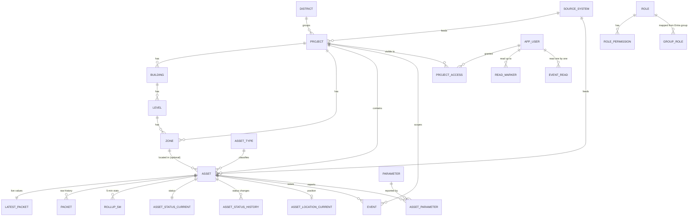

# 06 · Database design

- **Reference SQL:** `db/schema.sql`. It was tested on PostgreSQL 16 and runs as-is on Azure Database for PostgreSQL Flexible Server 16 and on on-premise PostgreSQL 16.
- **Migrations:** `db/migrations/NNNN_name.sql` (node-pg-migrate, with up and down). The schema file and the migrations must always describe the same state.
- **Why no TimescaleDB:** see `adr/0003-database-time-series.md` (amended by `adr/0007-sql-rollups-per-closed-bucket.md`).

## 1. Schemas and ownership
| Schema | Tables | Owned by module |
|---|---|---|
| `core` | `setting`, `feature_flag`, `source_system`, `district`, `project`, `building`, `level`, `zone`, `asset_type`, `asset`; views `v_asset_live`, `v_project_asset_counts` (equipment only), `v_site_metric_live` | portfolio, spatial, assets, config |
| `access` | `app_user`, `role`, `permission`, `role_permission`, `group_role`, `user_role`, `project_access`; functions `user_roles()`, `user_project_ids()` | access |
| `telemetry` | `parameter`, `asset_parameter`, `latest_packet`, `packet`, `rollup_5m`, `rollup_1h`, `rollup_1d`, `status_map`, `asset_status_current`, `asset_status_history`, `asset_location_current`, `asset_location_history` | telemetry |
| `events` | `event`, `event_read`, `read_marker` | events |
| `integration` | `sync_run`, `api_call`, `link_todo`, `cursor` | integrations |
| `audit` | `log` | audit |

Settings added in S1-01: `audit.sign_in_gap_minutes` (default 60, see `08` §2 step 6).

Columns added in S3-01 (the `catalogue_sync_details` migration; both nullable, both the last column of their table):
- `integration.sync_run.details jsonb`: the typed summary of one run, one shape per `job` (`SyncRunDetails` in `packages/shared`, a zod union the health API reads). `error` stays for failures only. For `catalogue_sync`: `seen`, `total`, `complete`, `inserted`, `updated`, `unchanged`, `reappeared`, `missed`, `retired`, `linkTodos` and `warnings[]`. A warning is a Nexus operational notice with a typed code (`incomplete_walk { seen, total }`, `retire_blocked { wouldRetire, active, fraction, maxFraction }`); a run with a warning has `status = 'partial'`. Warnings are **not** DATOMS alerts: they never go to `events.event` or `integration.link_todo`.
- `core.asset.source_lifecycle_status text`: the source's lifecycle label exactly as reported (DATOMS `lifecycle_status`; the field name stays in `mapping.ts`). **Display only:** never used for status colours, counts, poll scope or retirement. Using it for any of those needs an ADR and the answer to Q40.

## 2. Entity relationships


## 3. Key design decisions
1. **Source identity.** Every synced row has `source_system` and `external_id` (unique together). The DATOMS asset id `"36390"` is stored as text in `external_id`. Internal ids are `uuid`. This lets Nexus add a second data platform without collisions.
2. **Never delete synced rows.** A project or asset that DATOMS no longer returns gets `retired_at = now()`. Its history stays readable.
3. **One row per packet, not one row per parameter.** DATOMS sends about 103 parameters per asset per minute. Storing them as one `jsonb` object per packet keeps row counts about 100× lower and stores any new parameter with no schema change. `lz4` compression is set on the jsonb columns, and new partitions inherit it.
4. **Values exactly as reported.** `values` holds the source's keys and values unchanged. Display names and units come from `telemetry.parameter`, filled from the source. Admins may fill a gap only where the source gives nothing.
5. **Status as reported.** `asset_status_current.source_value` stores the DATOMS label exactly. `telemetry.status_map` translates labels to the four display colours (running, idle, maintenance, off). This is a lookup table of DATOMS's own labels; Nexus never works out a status from values. An unmapped label shows as `unknown` and creates a `link_todo` row of type `status_value` for an admin.
6. **Daily partitions** for `packet` and `api_call`; **monthly** for `rollup_5m`, `rollup_1h`, status and location histories, events, `event_read` and audit. `rollup_1d` is not partitioned (small, kept forever). Dropping a partition is instant retention, with no slow `DELETE`.
7. **Rollups instead of continuous aggregates (ADR 0007).** The `refresh_rollup_5m()` and `refresh_rollup_combine()` functions are safe to run again for any time window. In phase 1 they are the **only** rollup path. The worker runs `refresh_rollup_5m` **once per closed 5-minute bucket**, `rollup.close_grace_intervals` (2) poll intervals after the bucket ends, and again only for closed buckets that receive late packets. It never runs over a sliding window or every minute. Daily buckets are **local days in Asia/Dubai**. Each rollup row stores `packets`, the number of samples Nexus stored, which the API reports as data coverage.
8. **BIM-ready spatial model.** `building → level → zone`, with nullable `building_id / level_id / zone_id` on `core.asset` and `events.event`, and `bim_ref` jsonb for IFC GUIDs, APS URNs or ArcGIS I3S layer ids. `building`, `level` and `zone` each have nullable `source_system` + `external_id` (unique together) and `retired_at`, so a BIM model or another platform can feed them later with the same identity and never-delete rules as assets. **The database keeps the links consistent (S1-01):** composite foreign keys make an asset's building and zone belong to the asset's own project and its level to its own building; a CHECK refuses any building, level or zone on an asset that has no project, and another refuses a level without its building. `project_id` stays nullable only for a source asset not yet linked to a project (`integration.link_todo`); such an asset is never visible to a project-scoped user.
9. **Access is data.** Entra groups map to roles in `group_role`. Project scope sits in `project_access` (per user or per group). Roles with `all_projects = true` (admin, leadership) skip the project filter.
10. **Asset kind (ADR 0009).** `core.asset.kind` is `physical` for physical sensored items of any category (including DGs, solar and mains) or `site_metric` for site-level values as the source reports them, such as energy site totals. **Every equipment list, count, map layer and view filters `kind = 'physical'`.** `v_asset_live` and `v_project_asset_counts` already do. Site-level values are read through `v_site_metric_live`.
11. **Read state that doesn't grow with users × events.** "Mark all read" moves one row in `events.read_marker` (per user, either global or per project). `events.event_read` holds only events read one by one after the marker. It is partitioned by `occurred_at` like `events.event` and dropped with it. Unread = events in scope with `occurred_at` later than the user's latest applicable marker and no `event_read` row.
12. **Parameter dictionary per source type (ADR 0011).** `telemetry.parameter` is unique on `(source_system, source_type_name, key)`, not on the key alone, because the same DATOMS key has different names (and unit spellings) in different categories: 31 keys are shared across DG Set, Fuel Tank, AC Sub-Meter and Solar Inverter (`docs/source/datoms-parameters.md`). `source_type_name` is the category exactly as the source names it, the same string as `core.asset.source_type_name`; `NULL` means the type is not known yet (the constraint is `NULLS NOT DISTINCT`). It is a raw source string, not an FK to `core.asset_type`, so a Nexus type remap never changes a source name. Look up an asset's names with `source_type_name IS NOT DISTINCT FROM asset.source_type_name`; with no row, show the raw key and no unit, and never borrow another type's name. The DATOMS list of 12 Oct 2026 is loaded by `db/seeds/datoms-parameters.sql`, which also appends the four category names to `core.asset_type.source_names` (DG Set → `diesel_generator`, Fuel Tank → `fuel_tank`, AC Sub-Meter → `mains`, Solar Inverter → `solar`).

13. **Access changes reach every API instance (S1-01).** Triggers on `access.user_role`, `group_role`, `project_access`, `role`, `role_permission`, `permission` and on `app_user.is_active` send `NOTIFY nexus_access` (`{"scope":"user","userId":...}` or `{"scope":"all"}`) when the change commits, whoever made it (API, migration, manual SQL). Each API instance holds one `LISTEN` connection (a direct Postgres connection, not PgBouncer) and clears its access cache. A cache hit also checks `is_active`, a load that started before a change is never cached, and while the LISTEN connection is down the cache is off. See `08` §2.
14. **Partition maintenance is a privileged function, not a worker privilege.** `core.create_range_partitions` and `core.drop_partitions_before` are SECURITY DEFINER, owned by `nexus_migrator` (the owner of every table), with a pinned `search_path`. They accept only partitioned tables in the `telemetry`, `events`, `integration` and `audit` schemas, create partitions with UTC bounds whatever the caller's time zone, refuse a drop date in the future, and only `nexus_worker` may execute them. For `audit.log`, `events.event` and `events.event_read` they also refuse to create a partition older than 730 days or to drop one younger than that, so retention cannot be bypassed by moving rows into an old partition. **The retention settings are not clamped by the database**; the worker's maintenance job (S3-08) clamps them (§4 and §6a) and never passes a drop date younger than these floors. Nobody can lower `retention.audit_days` or `retention.event_days` below 730 without a migration that changes the floor.

## 4. Write paths (worker)
| Job | Writes | Rule |
|---|---|---|
| Catalogue sync (hourly, `GET /assets`) | `core.asset` (name, nameplate, **category** in `source_type_name` and the matching `asset_type_id`, `source_lifecycle_status`, `source_created_at`, `last_seen_at`), `integration.link_todo` (unknown category, no site), `integration.sync_run` (with `details`) | **The catalogue is the source of the asset category** (bulk rows carry no type): `category_name` is matched to `core.asset_type.source_names`; an unknown or missing one becomes `generic` plus a `link_todo`. `project_id` stays null plus a `link_todo` until site data exists (Q21, Q22; ADR 0012). Batched: at most 1,000 rows per statement (insert `ON CONFLICT DO NOTHING`, update from a `jsonb` batch, so a field the source leaves out never overwrites a stored one). Every asset in a walk gets `last_seen_at` (one batched UPDATE per 1,000 rows, so `updated_at` also moves hourly). **Retire safely:** only after a complete page walk where the number seen equals `pagination.total`, only for rows absent from `catalogue.retire_after_misses` (2) consecutive complete walks, and never more than `catalogue.retire_max_fraction` (5%) of active assets in one sync (then retire nothing and record a `retire_blocked` warning). **The miss counter is derived, not stored:** an asset is due when it is absent now and its `last_seen_at` is before the start of the oldest of the last `retire_after_misses − 1` earlier complete runs (`sync_run.details.complete = true`, newest first from `sync_run_job_time_idx`); with fewer complete runs on record nothing is due. Set `retired_at`, never delete; the worker role has no DELETE on `core.asset`. |
| Live poll (60 s, bulk endpoint only, ADR 0010) | `core.project` (sites), `core.asset_type` (new source type names become `generic` plus a `link_todo`), `core.asset` (site link, `kind`), `telemetry.parameter` (new `(source_type_name, key)` pairs, ADR 0011; `data_type` set once from the first value seen), `telemetry.packet` (insert … ON CONFLICT DO NOTHING), `telemetry.latest_packet` (upsert only if `ts` is newer; **replace `values` with the new packet's values, never merge** it with the stored object, so a parameter that went null stops showing its old value; null-valued keys are dropped before this write, `07` §4.6), `telemetry.asset_parameter` (**insert new pairs only**), `asset_status_current` + `asset_status_history` (**on change only**), `asset_location_*` (on change only), `events.event` (alerts from the bulk rows) | Skip a packet whose `ts` is not newer than the stored `latest_packet.ts`. Reject a `ts` more than 10 minutes in the future (log it). **No per-poll bookkeeping updates:** the worker keeps known (asset, parameter) pairs in memory and refreshes `asset_parameter.last_seen_at` at most daily. `asset_status_current.observed_at` is written on change only. Rows for DATOMS ids that the catalogue doesn't know yet are skipped, counted in `sync_run` and trigger an early catalogue sync (at most once per 5 min). |
| Rollups (ADR 0007) | `rollup_5m`, `rollup_1h`, `rollup_1d` | **5 min:** `refresh_rollup_5m(bucket_start, bucket_end)` runs **once per closed bucket**, at bucket end + `rollup.close_grace_intervals` × the current poll interval (default 2 × 60 s). The poll job records the oldest `ts` it wrote. If that falls in an already-closed bucket, only those buckets are refreshed again. **1 h:** `refresh_rollup_combine` right after the hour's last 5-minute bucket is refreshed, in batches of 1,000 assets. **1 d:** once per closed Dubai day. No sliding window, no per-minute refresh, and no in-memory accumulators in phase 1 (that is a scale trigger in `12` §2). The live screen never waits for rollups; charts of the current hour or day read the finer table for the open part. |
| Alerts (in the live poll) | `events.event` | Upsert on `(source_system, external_id, occurred_at)`. Alerts come from the bulk response (ADR 0010); there is no separate events-sync job. |
| Maintenance (daily 02:00 Dubai, and once at start-up) | **Create ahead** with `core.create_range_partitions`: daily tables (`packet`, `api_call`) from yesterday to 7 days ahead, monthly tables (`rollup_5m`, `rollup_1h`, status and location history, `events.event`, `event_read`, `audit.log`) for this and the next 2 months. **Drop expired** with `core.drop_partitions_before` (a partition goes when its whole range is older than the retention). **Prune** `integration.sync_run` older than `retention.sync_run_days` (90), always keeping the newest `catalogue.retire_after_misses` complete catalogue runs per source (`07` §6). **Record** a `sync_run` row (`job = 'maintenance'`, source `nexus`) with `details` = created, dropped, clamped, `syncRunsPruned`, warnings. Archiving to Blob is **deferred** (`archive.enabled = false`, ADR 0008, Q15). | Settings in `core.setting`: `retention.packet_days` (90, stays until Q15), `rollup_5m_days` (**60**), `rollup_1h_days`, `event_days` (also used for `event_read`), `status_history_days`, `location_history_days`, `api_call_days`, `audit_days`, `sync_run_days`. `rollup_1d` is kept forever. **Every value is clamped to a safe minimum** (see §6a); a clamp is logged and listed in `details.clamped`. Health: if tomorrow's daily or next month's monthly partition is missing after the run, the job records a `partition_missing` warning (log event and metric `nexus.sync.warning`), and the run is `partial`. A failing step is a `step_failed` warning; the other steps still run. |

Bulk writes use multi-row `INSERT … SELECT FROM unnest(...)` or `COPY`, one transaction per page of 500 assets. `latest_packet` (fillfactor 70) and `asset_status_current` (fillfactor 80) leave free space on each page so the frequent updates stay HOT, with no index churn.

## 5. Read paths (API): examples
```sql
-- Project page markers (one query, ~ms). Equipment only (the view filters kind = 'physical').
-- The marker list does not select latest_values (live messages are slim; the asset panel fetches values).
SELECT asset_id, name, asset_type, category, icon, status_display, status_source_value,
       last_packet_at, latitude, longitude
FROM core.v_asset_live WHERE project_id = $1;

-- Info box 2 counts (equipment only)
SELECT asset_type, status_display, assets FROM core.v_project_asset_counts WHERE project_id = $1;

-- Energy site totals as reported (site-level records, kind = 'site_metric')
SELECT name, last_packet_at, latest_values FROM core.v_site_metric_live WHERE project_id = $1;

-- Trend: one parameter over a range, choosing the table by range length and retention
--   ≤ 6 h → telemetry.packet ; ≤ 7 d AND within retention.rollup_5m_days (60) → rollup_5m ;
--   ≤ 90 d → rollup_1h ; else → rollup_1d. The API returns the resolution it actually used.
-- `packets` is returned with each bucket as data coverage (ADR 0007).
SELECT bucket, packets, (stats->$2->>'avg')::numeric AS avg,
       (stats->$2->>'min')::numeric AS min, (stats->$2->>'max')::numeric AS max
FROM telemetry.rollup_1h
WHERE asset_id = $1 AND bucket >= $3 AND bucket < $4
ORDER BY bucket;

-- Raw values for short ranges
SELECT ts, values->$2 AS v FROM telemetry.packet
WHERE asset_id = $1 AND ts >= $3 AND ts < $4 ORDER BY ts;

-- Device card: latest values with names and units for THIS asset's source type (ADR 0011).
-- No dictionary row (or no name) = the API returns the raw key and no unit. Never join on key alone.
-- Project scope applies as on every asset query (withProjectScope on a.project_id).
SELECT e.key, e.value, p.display_name, p.unit, p.data_type, lp.ts
FROM core.asset a
JOIN telemetry.latest_packet lp ON lp.asset_id = a.id
CROSS JOIN LATERAL jsonb_each(lp.values) e
LEFT JOIN telemetry.parameter p
       ON p.source_system = a.source_system
      AND p.source_type_name IS NOT DISTINCT FROM a.source_type_name
      AND p.key = e.key
WHERE a.id = $1 AND (p.is_hidden IS NOT TRUE);

-- Project scope for a user (the API caches the result for 5 min per user)
SELECT * FROM access.user_project_ids($user_id, $group_ids);
```
**Every API query that returns project data must filter by the user's project ids**, unless the user's role has `all_projects`. Put this filter in the repository layer (`withProjectScope(qb, scope)`), never in a controller.

## 6. Measured performance (7 Oct 2026 benchmark)
Test machine: PostgreSQL 16.13 with 2 vCPU and 8 GB RAM (shared_buffers 2 GB), about the size of an Azure General Purpose 2-vCore server. Data:
- 100 projects; 5,000 assets (25,000 for the search test)
- 300 assets × 1 day of 1-minute packets with 103 parameters (432,000 rows, 591 MB)
- 5-minute rollups for 8 days (2.8 GB), hourly for 180 days (5.3 GB), daily for 3 years
- 1,000,000 events over 6 months

| Screen / job | Query | Warm | Cold (first run) |
|---|---|---|---|
| Portfolio map (all 100 projects + asset counts) | project ⟕ asset group by | 2 ms | 3 ms |
| Portfolio for a scoped user (20 projects) | `access.user_project_ids()` | 0.6 ms | 2 ms |
| Project page markers + live values (50 assets) | `v_asset_live` | 2 ms | 9 ms |
| Info box 2 counts | `v_project_asset_counts` | 1 ms | 1 ms |
| Energy box (sum over generators) | latest_packet join | 1 ms | 2 ms |
| Asset search "contains" over **25,000 assets** | trigram GIN index | **0.5 ms** | 2 ms |
| Trend 6 h raw (1 parameter) | packet | 2 ms | 7 ms |
| Trend 7 days | rollup_5m | 17 ms | 210 ms |
| Trend 90 days | rollup_1h | 22 ms | 361 ms |
| Trend 3 years | rollup_1d | 16 ms | 20 ms |
| Explorer: 10 assets × 30 days, min/avg/max | rollup_1h | 143 ms | 403 ms |
| Notifications: latest 50 for a project (of 1 M) | event index | 1 ms | 3 ms |
| Unread count, 20 projects, 30 days | event ⟕ event_read | 24 ms | 45 ms |
| One poll write (300 packets + 300 latest upserts) | insert/upsert | 6 ms | — |
| 5-min rollup in SQL, one closed bucket, 300 assets | `refresh_rollup_5m` | 0.68 s | — |
| 5-min rollup in SQL, sliding 15-min window, 300 assets (not used; for comparison) | `refresh_rollup_5m` | 1.6 s | — |
| Hourly close, one hour, 300 assets | `refresh_rollup_combine` | 1.8 s | — |

**What this means:**
- Every screen query is well inside the N-04 target (p95 < 300 ms for live screens, < 1 s for charts), including cold reads. Cold reads only happen after a restart; afterwards the data is cached.
- The DB load from users is tiny. The heavy work is the rollups.
- **Rollups (ADR 0007):** SQL-side rollups parse every jsonb packet (~0.3 ms per packet). A sliding SQL refresh every minute would take ~25–30 s at 5,000 assets, so it is never used. Phase 1 refreshes each **closed** 5-minute bucket once: about 0.68 s at 300 assets, an estimated ~11 s per 5 minutes at 5,000 and ~45 s at 20,000. Hourly and daily combines run once per period; the hourly close is estimated at ~30 s at 5,000 assets and ~2 min at 20,000, in the background, batched by 1,000 assets. If the closed-bucket refresh passes 30 s, the `12` §2 trigger moves 5-minute rollups into the worker's memory (new ADR).
- **Re-benchmark with real fixtures in S2/S3.** This benchmark used random values and short keys (`p001`…`p103`). Re-run it with the recorded DATOMS sample (Q21) once it arrives, including the closed-bucket refresh time and the row sizes in section 6a. Decide then whether a more compact rollup `stats` format is needed (an ADR if it changes).
- Re-run this benchmark (the `db/seeds/scale-100-sites.ts` seed plus these queries) after any schema change on telemetry tables, and paste the table into the PR.

## 6c. Re-run on the real schema with the DATOMS parameter keys (S1-01, 14 Oct 2026)
Command: `pnpm db:seed:scale` (`db/seeds/scale-100-sites.ts`, queries in `db/bench/screens.ts`, see `db/bench/README.md`). Machine: PostgreSQL 16.15 on Windows, shared_buffers **128 MB** (the 7 Oct run used 2 GB), a developer laptop with other programs running, so **absolute times are pessimistic and the "first run" column is not a cold-cache measurement**. Data: 100 projects, 5,000 assets (4,800 physical, 200 `site_metric`, about 60% in a zone), **3,026,400 packets** (300 assets x 7 days; 70 DG Set with 103 keys, 33 Fuel Tank with 4, 132 AC Sub-Meter with 34, 65 Solar Inverter with 23: the real DATOMS keys, random values), rollups 5-minute 7 days, hourly 90 days, daily 3 years (the older ones copied from a real row), 1,000,000 events over 180 days.

| Screen / job | Rows | First run (ms) | Warm median (ms) | N-04 target (ms) |
|---|---|---|---|---|
| Portfolio map (100 projects + equipment counts) | 100 | 4.0 | 3.5 | 300 |
| Portfolio for a scoped user (20 projects) | 20 | 5.4 | 0.5 | 300 |
| Project page markers (`v_asset_live`, 48 assets) | 48 | 202.0 | 3.6 | 300 |
| Info box 2 counts | 15 | 2.2 | 2.2 | 300 |
| Energy box: site totals (`v_site_metric_live`) | 2 | 0.6 | 0.4 | 300 |
| Energy box: sum over the DG Sets of a project | 1 | 0.6 | 0.7 | 300 |
| Asset search "contains" over 5,000 assets (trigram) | 50 | 1.1 | 0.5 | 300 |
| Device card (103 values with names and units) | 103 | 1.1 | 0.8 | 300 |
| Trend 6 h, raw packets | 321 | 71.0 | 2.8 | 1,000 |
| Trend 7 days, 5-minute rollups | 2,008 | 91.6 | 30.9 | 1,000 |
| Trend 90 days, hourly rollups | 2,153 | 367.1 | 45.7 | 1,000 |
| Trend 3 years, daily rollups | 1,097 | 661.3 | 28.8 | 1,000 |
| Explorer: 10 assets x 30 days hourly | 10 | 645.1 | 189.7 | 1,000 |
| Notifications: latest 50 for a project (90 days) | 50 | 2.4 | 1.2 | 300 |
| Notifications: unread count, 20 projects, 30 days | 1 | 116.3 | 36.6 | 300 |
| One poll write (300 packets + 300 latest upserts) | | 16.3 | | 300 |

Every query is under its target, first run included.

| Job (one run, 300 assets with packets) | Time | Scaled linearly to 5,000 assets |
|---|---|---|
| `refresh_rollup_5m`, one closed 5-minute bucket (median of 5) | 402 ms | ~6.7 s per 5 minutes |
| `refresh_rollup_combine`, one hourly close | 935 ms | ~15.6 s per hour |
| `refresh_rollup_combine`, one Dubai day close | 1.8 s | ~30 s per day |

The 30 s trigger of `12` §2 is not reached (5,000 assets would use about 6.7 s of every 300 s). Bulk backfill is slower per packet than the closed-bucket unit: 8 day windows of 5-minute rollups took 200 to 290 s each at this load, which is why `seed:scale` is a one-off and why backfills must run by day windows, never inside the live loop.

| Table | Rows | Heap | Indexes | Total | Bytes per row (total) |
|---|---|---|---|---|---|
| `telemetry.packet` (7 days) | 3,026,400 | 2.92 GB | 218 MB | 3.14 GB | 1,114 |
| `telemetry.rollup_5m` (7 days) | 605,700 | 485 MB | 40 MB | 1.12 GB | 1,987 |
| `telemetry.rollup_1h` (90 days) | 646,200 | 616 MB | 42 MB | 1.51 GB | 2,506 |
| `telemetry.rollup_1d` (3 years) | 329,400 | 315 MB | 22 MB | 788 MB | 2,509 |
| `events.event` | 1,000,000 | 156 MB | 284 MB | 441 MB | 462 |

(`total` includes TOAST, which holds the compressed jsonb.) `packet_ts_idx` is 20 MB over 3 M rows (about 7 bytes per row). Packet rows are smaller than in the 7 Oct run (1.1 KB against 1.37 KB) and rollup rows about half (2.0 to 2.5 KB against 4.05 KB), because the real category mix averages about 43 numeric keys per asset, not 103. The 6a table below still assumes 103 keys for every asset; treat it as the upper bound until the S2/S3 re-run with recorded fixtures. No change to the table design or to `packet_ts_idx` is proposed (no `EXPLAIN ANALYZE` evidence for BRIN yet).

## 6a. Sizing estimates (from the benchmark's measured row sizes)
Measured on 7 Oct 2026: about **1.37 KB per raw packet row** (591 MB for 432,000 rows) and about **4.05 KB per rollup row** (5-minute: 2.8 GB for 691,200 rows; hourly: 5.3 GB for 1,296,000 rows). Rollup rows are larger because each of the ~103 parameters stores min, max, avg, last and n. Per asset per day: raw ≈ 1.97 MB, 5-minute ≈ 1.17 MB, hourly ≈ 98 KB.

These assume 1 packet per asset per minute and 103 numeric parameters, with the retention in `core.setting` (raw 90 days, 5-minute **60 days**, hourly 5 years). The benchmark used random values and short keys, so real data may be smaller (repeating values compress better) or larger (longer keys). **Re-measure with real fixtures in S2/S3.**

| Fleet | Packets/day | Raw packets (90 d) | 5-min rollups (60 d) | Hourly (5 years) | Total at steady state |
|---|---|---|---|---|---|
| 250 assets (pilot) | 360 k | ~44 GB | ~18 GB | ~45 GB (~9 GB/yr) | ~105 GB |
| 2,000 assets | 2.9 M | ~355 GB | ~140 GB | ~360 GB (~72 GB/yr) | ~0.85 TB |
| 20,000 assets | 29 M | ~3.5 TB | ~1.4 TB | ~3.6 TB (~0.7 TB/yr) | ~8.5 TB |

Add indexes (~10–20%), and remember that zone-redundant HA keeps a second copy. Raw packets pass 1 TB at about **5,600 assets**. That is the planned point for the raw-telemetry step in `12-scalability.md` §2: archive or move raw packets, with an ADR. If the measured size is high, first lower `retention.packet_days` (Innovo decides, Q15), or archive raw partitions to Blob as Parquet (deferred, ADR 0008). Do not change the table design without an ADR.

**Retention floors (S3-08, security review N7).** The database clamps nothing except the 730-day floor of audit and events, so the maintenance job clamps every `retention.*_days` before use. A missing, non-numeric or too-small value is replaced (below the minimum: the minimum; invalid: the default, but never below the minimum) and reported.

| Setting | Default | Minimum used by the job |
|---|---|---|
| `retention.packet_days` | 90 | 7 |
| `retention.rollup_5m_days` | 60 | 7 |
| `retention.rollup_1h_days` | 1830 | 90 |
| `retention.api_call_days` | 30 | 7 |
| `retention.status_history_days` | 730 | 30 |
| `retention.location_history_days` | 400 | 30 |
| `retention.sync_run_days` | 90 | 7 (and the newest `catalogue.retire_after_misses` complete catalogue runs per source are never pruned) |
| `retention.audit_days`, `retention.event_days` | 730 | 730 (the database floor) |

A drop date is always now minus the retention in days, so it can never be in the future. Raising a minimum later is a code change; lowering the audit or event floor needs a migration of the database functions.

## 7. Indexes (already in the schema)
- `asset(project_id)` (partial, active only), `asset(asset_type_id)`.
- **Search:** trigram GIN indexes (`pg_trgm`) on `asset.name`, `project.name` and `event.title`. These make `ILIKE '%text%'` fast at any size (0.5 ms over 25,000 assets). Search endpoints must use `ILIKE` on these columns (or `similarity()` for typo-tolerant search) and always apply project scope.
- `packet` primary key `(asset_id, ts)` for history per asset, and `packet(ts)` for the closed-bucket rollup scans. A BRIN index on `ts` may replace the B-tree (much smaller, since inserts arrive in time order), but only with `EXPLAIN ANALYZE` evidence from the S2/S3 re-benchmark.
- `event_read` primary key `(user_id, event_id, occurred_at)`; `read_marker` unique per user (global) and per user + project.
- Rollup primary keys `(asset_id, bucket)`.
- `event(project_id, occurred_at DESC)` and `event(asset_id, occurred_at DESC)`.
- `project_access` by user and by group.
- `building(id, project_id)`, `level(id, building_id)` and `zone(id, project_id)` are unique so that `core.asset` can reference them in the composite foreign keys of decision 8 (small tables, no extra write cost on hot rows).
- Add new indexes only with a measured slow query (`EXPLAIN ANALYZE` in the PR).

## 8. Migration rules
1. One migration per PR. Use a sequential number. Never edit a migration once it is merged. **`db/migrations/0001_init.sql` is frozen** (Ahmed, 2026-10-19): every schema change, including a new setting or partition change, is a new migration plus the `db/schema.sql` update, and `pnpm db:check` must pass.
2. Every `up` has a working `down`.
3. No locking changes on hot tables during the day: build indexes `CONCURRENTLY` and add columns as nullable first.
4. Update `db/schema.sql` in the same PR and run `pnpm db:check`. It applies all migrations (with the real runner, including `db/roles.sql`) to one empty DB and loads `schema.sql` into another, then diffs `pg_dump --schema-only` of both (no owners or grants, partition children `*_p20..` and the migrations table left out). Reference data is compared separately: every row of every ordinary table, without timestamps and generated uuids. It also fails if `db/src/types.ts` (generated by `kysely-codegen`) is stale. This keeps the check stable whatever the date. `pnpm db:migrate` runs migrations as `nexus_migrator`, then applies `db/roles.sql`; `down` reverts one migration (`down all`, `redo`). See `db/README.md`.
5. Seed data that differs between environments goes in `db/seeds/`, not in migrations. So does **source data delivered outside the API**: `db/seeds/datoms-parameters.sql` (the DATOMS parameter list and category → asset type names, ADR 0011) runs in every environment, is idempotent, and is the only file to change when DATOMS updates the list or Q35 corrects a category name.

## 9. Database security
- App roles and exact grants are in `db/roles.sql`, which `pnpm db:migrate` re-applies after every migration run (a new table gets its grants there, and nothing is granted by default):
  - `nexus_api`: read on everything, plus `EXECUTE` on `access.user_roles` and `access.user_project_ids` only. Writes on: `access.app_user` (insert, update), `access.group_role`, `user_role` and `project_access`; **not** `access.role`, `permission` or `role_permission` (reference data, changed only by migrations) and no delete of users; `events.event_read` and `events.read_marker`; `audit.log` (insert only); the project, district and spatial tables (insert, and update of the admin-held columns only; source identity and `*_seen_at` stay with the connector); `core.asset` (link columns only, not `kind`); `asset_type` (including `poll_interval_seconds`), `setting`, `feature_flag`, `status_map`; `telemetry.parameter` (display columns only); `integration.link_todo`.
  - `nexus_worker`: read on `core`, `telemetry`, `events.event` and `integration`. **No access at all** to `access`, `audit` or the per-user read-state tables (`events.event_read`, `events.read_marker` and their partitions). Writes: `core.project`, `asset`, `asset_type` (insert, update); `telemetry.*` (insert, update) except `status_map` (read only; admins manage it); `events.event` (insert, and update only of the columns an alert update changes, not `id`, `occurred_at`, `source_system`, `external_id` or `received_at`, so a row cannot be moved into an old partition); `integration.*` (insert, update) and `DELETE` on `integration.sync_run` only. `EXECUTE` on the rollup functions and, for partition maintenance, the SECURITY DEFINER functions (decision 14). No other `DELETE` anywhere. S3-08 changed no grant: the maintenance job lists partitions from the catalog by name (a `regclass` cast would fail, because the worker has no `USAGE` on schema `audit`), prunes `integration.sync_run` with the existing `DELETE`, and drops and creates partitions only through the functions, which also write the `audit.log` row.
  - `nexus_migrator`: DDL, and owns the functions.
  Every role has the least access it needs.
- **One server per environment.** The database-level PUBLIC rights (CONNECT, TEMPORARY) are revoked and only the three Nexus roles get CONNECT, but roles are cluster-wide: dev and prod must be different servers, never two databases on one server, and no other application shares a Nexus server.
- Review hardening (PR #16): the worker has no access to `access.*`, `audit.log` or the per-user read-state tables (not even their partitions), has `INSERT` and a column-limited `UPDATE` on `events.event` only, and `DELETE` only on `integration.sync_run`; the API's `UPDATE` on projects, districts and spatial rows is limited to the admin-held columns (source identity, `*_seen_at` and the project's `retired_at` stay with the connector); there are no default privileges, and functions are granted one by one (the API gets only `access.user_roles` and `user_project_ids`; a new SECURITY DEFINER function is executable by nobody until granted); `drop_partitions_before` keeps 730 days of `audit.log` and `events`, and writes an `audit.log` row for every partition it drops; `refresh_rollup_combine` takes `regclass` arguments limited to the two allowed pairs and is SECURITY INVOKER (like `refresh_rollup_5m`). `db:migrate down`/`redo` need `--confirm-database=<name>` unless `APP_ENV=local` and the database host is local (checked inside `migrate()`), and `dev-login-roles.sql` runs only against localhost, loopback or a unix socket.
- Migrations and seeds connect with `DATABASE_ADMIN_URL`, the API with `DATABASE_URL` and the worker with `WORKER_DATABASE_URL` (three different logins; `docs/04`). Only the local environment may fall back to `DATABASE_URL`. `nexus_migrator` owns every table and function; `nexus_api` cannot change `access.role`, `role_permission` or `permission` (reference data changed only by migrations), cannot delete users and can only insert into `audit.log`; the partition functions are executable by `nexus_worker` only.
- These roles are NOLOGIN. Locally only (`APP_ENV=local`), `db/seeds/dev-login-roles.sql` adds passwordless LOGIN users `nexus_api_local` and `nexus_worker_local`, each a member of one role and nothing else, so local runs hit the same permission errors as Azure. The seed refuses to run unless the session has `nexus.app_env = 'local'`.
- The API never connects as the owner. Entra (managed identity) is used for database auth in Azure where possible.
- Prod: private endpoint only, TLS required, PITR backups for 35 days, and a restore test every quarter (S8-02).
