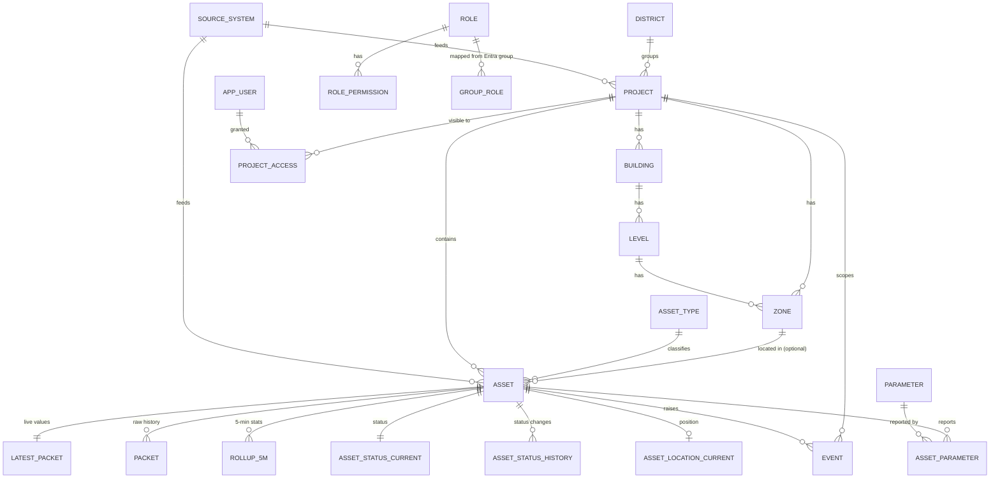

# 06 · Database design

- **Reference SQL:** `db/schema.sql`. It was tested on PostgreSQL 16 and runs as-is on Azure Database for PostgreSQL Flexible Server 16 and on on-premise PostgreSQL 16.
- **Migrations:** `db/migrations/NNNN_name.sql` (node-pg-migrate, with up and down). The schema file and the migrations must always describe the same state.
- **Why no TimescaleDB:** see `adr/0003-database-time-series.md`.

## 1. Schemas and ownership
| Schema | Tables | Owned by module |
|---|---|---|
| `core` | `setting`, `feature_flag`, `source_system`, `district`, `project`, `building`, `level`, `zone`, `asset_type`, `asset`; views `v_asset_live`, `v_project_asset_counts` | portfolio, spatial, assets, config |
| `access` | `app_user`, `role`, `permission`, `role_permission`, `group_role`, `user_role`, `project_access`; functions `user_roles()`, `user_project_ids()` | access |
| `telemetry` | `parameter`, `asset_parameter`, `latest_packet`, `packet`, `rollup_5m`, `rollup_1h`, `rollup_1d`, `status_map`, `asset_status_current`, `asset_status_history`, `asset_location_current`, `asset_location_history` | telemetry |
| `events` | `event`, `event_read` | events |
| `integration` | `sync_run`, `api_call`, `link_todo`, `cursor` | integrations |
| `audit` | `log` | audit |

## 2. Entity relationships


## 3. Key design decisions
1. **Source identity.** Every synced row has `source_system` and `external_id` (unique together). The DATOMS asset id `"36390"` is stored as text in `external_id`. Internal ids are `uuid`. This lets Nexus add a second data platform without collisions.
2. **Never delete synced rows.** A project or asset that DATOMS no longer returns gets `retired_at = now()`. Its history stays readable.
3. **One row per packet, not one row per parameter.** DATOMS sends about 103 parameters per asset per minute. Storing them as one `jsonb` object per packet keeps row counts about 100× lower and stores any new parameter with no schema change. `lz4` compression is set on the jsonb columns, and new partitions inherit it.
4. **Values exactly as reported.** `values` holds the source's keys and values unchanged. Display names and units come from `telemetry.parameter`, filled from the source. Admins may fill a gap only where the source gives nothing.
5. **Status as reported.** `asset_status_current.source_value` stores the DATOMS label exactly. `telemetry.status_map` translates labels to the four display colours (running, idle, maintenance, off). This is a lookup table of DATOMS's own labels; Nexus never works out a status from values. An unmapped label shows as `unknown` and creates a `link_todo` row of type `status_value` for an admin.
6. **Daily partitions** for `packet` and `api_call`; **monthly** for `rollup_5m`, `rollup_1h`, status and location histories, events and audit. `rollup_1d` is not partitioned (small, kept forever). Dropping a partition is instant retention, with no slow `DELETE`.
7. **Rollups instead of continuous aggregates.** The `refresh_rollup_5m()` and `refresh_rollup_combine()` functions are safe to run again for any time window. The worker calls them every minute for the recent window and again for late data. Daily buckets are **local days in Asia/Dubai**.
8. **BIM-ready spatial model.** `building → level → zone`, with nullable `building_id / level_id / zone_id` on `core.asset` and `events.event`, and `bim_ref` jsonb for IFC GUIDs, APS URNs or ArcGIS I3S layer ids.
9. **Access is data.** Entra groups map to roles in `group_role`. Project scope sits in `project_access` (per user or per group). Roles with `all_projects = true` (admin, leadership) skip the project filter.

## 4. Write paths (worker)
| Job | Writes | Rule |
|---|---|---|
| Catalogue sync (hourly) | `core.project`, `core.asset`, `core.asset_type` (new source names become `generic` plus a `link_todo`), `telemetry.parameter` | Upsert on `(source_system, external_id)`; set `last_seen_at`; retire missing rows |
| Live poll (60 s) | `telemetry.packet` (insert … ON CONFLICT DO NOTHING), `telemetry.latest_packet` (upsert only if `ts` is newer), `telemetry.asset_parameter`, `asset_status_current` + `asset_status_history` (on change only), `asset_location_*` (on change only) | Skip a packet whose `ts` is not newer than the stored `latest_packet.ts`. Reject a `ts` more than 10 minutes in the future (log it). |
| Rollups | **5 min: built in the worker's memory** from the packets it writes (min, max, sum, count, last per numeric parameter, per asset). One upsert per asset when each 5-minute bucket closes. **1 h:** `refresh_rollup_combine` once per closed hour, in batches of 1,000 assets. **1 d:** once per closed Dubai day. The live screen never waits for rollups; charts of the current hour or day read the finer table for the open part. | `refresh_rollup_5m()` (SQL) is the **recovery path only**: rebuild the open bucket after a worker restart, late packets (the poll job records the oldest time it touched), and history backfill. Never call it every minute over a sliding window (measured: too slow at scale, see section 6). |
| Events sync | `events.event` | Upsert on `(source_system, external_id, occurred_at)` |
| Maintenance (daily 02:00 Dubai) | Creates 7 days of future daily partitions and 2 months of future monthly ones; drops partitions past retention (archives first if `archive.enabled`) | Settings in `core.setting`: `retention.packet_days`, `rollup_5m_days`, `rollup_1h_days`, `event_days`, `status_history_days`, `location_history_days`, `api_call_days`, `audit_days`. `rollup_1d` is kept forever. |

Bulk writes use multi-row `INSERT … SELECT FROM unnest(...)` or `COPY`, one transaction per page of 500 assets.

## 5. Read paths (API): examples
```sql
-- Project page markers + info box data (one query, ~ms)
SELECT * FROM core.v_asset_live WHERE project_id = $1;

-- Info box 2 counts
SELECT asset_type, status_display, assets FROM core.v_project_asset_counts WHERE project_id = $1;

-- Trend: one parameter over a range, choosing the table by range length
--   ≤ 6 h → telemetry.packet ; ≤ 7 d → rollup_5m ; ≤ 90 d → rollup_1h ; else → rollup_1d
SELECT bucket, (stats->$2->>'avg')::numeric AS avg,
       (stats->$2->>'min')::numeric AS min, (stats->$2->>'max')::numeric AS max
FROM telemetry.rollup_1h
WHERE asset_id = $1 AND bucket >= $3 AND bucket < $4
ORDER BY bucket;

-- Raw values for short ranges
SELECT ts, values->$2 AS v FROM telemetry.packet
WHERE asset_id = $1 AND ts >= $3 AND ts < $4 ORDER BY ts;

-- Project scope for a user (the API caches the result for 5 min per user)
SELECT * FROM access.user_project_ids($user_id, $group_ids);
```
**Every API query that returns project data must filter by the user's project ids**, unless the user's role has `all_projects`. Put this filter in the repository layer (`withProjectScope(qb, scope)`), never in a controller.

## 6. Measured performance (7 Oct 2026 benchmark)
Test machine: PostgreSQL 16.13 with 2 vCPU and 8 GB RAM (shared_buffers 2 GB), about the size of an Azure General Purpose 2-vCore server. Data:
- 100 projects; 5,000 assets (25,000 for the search test)
- 300 assets × 1 day of 1-minute packets with 103 parameters (432,000 rows, 591 MB)
- 5-minute rollups for 8 days (2.8 GB), hourly for 180 days (5.3 GB), daily for 3 years
- 1,000,000 events over 6 months

| Screen / job | Query | Warm | Cold (first run) |
|---|---|---|---|
| Portfolio map (all 100 projects + asset counts) | project ⟕ asset group by | 2 ms | 3 ms |
| Portfolio for a scoped user (20 projects) | `access.user_project_ids()` | 0.6 ms | 2 ms |
| Project page markers + live values (50 assets) | `v_asset_live` | 2 ms | 9 ms |
| Info box 2 counts | `v_project_asset_counts` | 1 ms | 1 ms |
| Energy box (sum over generators) | latest_packet join | 1 ms | 2 ms |
| Asset search "contains" over **25,000 assets** | trigram GIN index | **0.5 ms** | 2 ms |
| Trend 6 h raw (1 parameter) | packet | 2 ms | 7 ms |
| Trend 7 days | rollup_5m | 17 ms | 210 ms |
| Trend 90 days | rollup_1h | 22 ms | 361 ms |
| Trend 3 years | rollup_1d | 16 ms | 20 ms |
| Explorer: 10 assets × 30 days, min/avg/max | rollup_1h | 143 ms | 403 ms |
| Notifications: latest 50 for a project (of 1 M) | event index | 1 ms | 3 ms |
| Unread count, 20 projects, 30 days | event ⟕ event_read | 24 ms | 45 ms |
| One poll write (300 packets + 300 latest upserts) | insert/upsert | 6 ms | — |
| 5-min rollup in SQL, one closed bucket, 300 assets | `refresh_rollup_5m` | 0.68 s | — |
| 5-min rollup in SQL, sliding 15-min window, 300 assets | `refresh_rollup_5m` | 1.6 s | — |
| Hourly close, one hour, 300 assets | `refresh_rollup_combine` | 1.8 s | — |

**What this means:**
- Every screen query is well inside the N-04 target (p95 < 300 ms for live screens, < 1 s for charts), including cold reads. Cold reads only happen after a restart; afterwards the data is cached.
- The DB load from users is tiny. The heavy work is the rollups.
- **Rollups:** SQL-side rollups parse every jsonb packet (~0.3 ms per packet). A sliding SQL refresh every minute would take ~25–30 s at 5,000 assets, so the design is: in-memory 5-minute rollups in the worker (near-zero DB cost), with SQL only for recovery, and hourly and daily combines once per period. The estimates for hourly close are ~30 s at 5,000 assets and ~2 min at 20,000; this runs in the background, batched by 1,000 assets.
- Re-run this benchmark (the `db/seeds/scale-100-sites.ts` seed plus these queries) after any schema change on telemetry tables, and paste the table into the PR.

## 6a. Sizing estimates (measured: 591 MB per day for 300 assets of raw packets with random values; real readings compress better)
These assume about 1 packet per asset per minute and about 103 numeric parameters per packet. They are estimates; measure the real numbers.

| Fleet | Packets/day | Raw packets (90 days) | 5-min rollups (400 days) | Hourly (5 years) |
|---|---|---|---|---|
| 250 assets (now) | 360 k | ~35–80 GB | ~25–60 GB | ~10–20 GB |
| 2,000 assets | 2.9 M | ~0.3–0.6 TB | ~0.2–0.5 TB | ~0.1 TB |
| 20,000 assets | 29 M | Move raw history off PostgreSQL (see `12-scalability.md`) | | |

If the measured size is high, first lower `retention.packet_days`, or archive raw partitions to Blob as Parquet. Do not change the table design.

## 7. Indexes (already in the schema)
- `asset(project_id)` (partial, active only), `asset(asset_type_id)`.
- **Search:** trigram GIN indexes (`pg_trgm`) on `asset.name`, `project.name` and `event.title`. These make `ILIKE '%text%'` fast at any size (0.5 ms over 25,000 assets). Search endpoints must use `ILIKE` on these columns (or `similarity()` for typo-tolerant search) and always apply project scope.
- `packet` primary key `(asset_id, ts)` for history per asset, and `packet(ts)` for rollup scans.
- Rollup primary keys `(asset_id, bucket)`.
- `event(project_id, occurred_at DESC)` and `event(asset_id, occurred_at DESC)`.
- `project_access` by user and by group.
- Add new indexes only with a measured slow query (`EXPLAIN ANALYZE` in the PR).

## 8. Migration rules
1. One migration per PR. Use a sequential number. Never edit a migration once it is merged.
2. Every `up` has a working `down`.
3. No locking changes on hot tables during the day: build indexes `CONCURRENTLY` and add columns as nullable first.
4. Update `db/schema.sql` in the same PR, and run `pnpm db:check`. It applies all migrations to one empty DB and `schema.sql` to another, then diffs `pg_dump --schema-only` of both, excluding partition child tables (`*_pYYYYMM*`). Reference data (the INSERTs) is compared separately with a sorted `COPY` of those tables. This keeps the check stable whatever the date.
5. Seed data that differs between environments goes in `db/seeds/`, not in migrations.

## 9. Database security
- App roles and exact grants are in `db/roles.sql` (run once per environment):
  - `nexus_api`: read on everything. Writes on: `access.*`; `events.event_read`; `audit.log` (insert); the admin-held project and spatial tables; `core.asset` (link columns only); `asset_type`, `setting`, `feature_flag`, `status_map`; `telemetry.parameter` (display columns only); `integration.link_todo`.
  - `nexus_worker`: read on everything. Writes on synced `core.project/asset/asset_type`, `telemetry.*`, `events.event`, `integration.*`. Partition maintenance goes through SECURITY DEFINER functions.
  - `nexus_migrator`: DDL, and owns the functions.
  Every role has the least access it needs.
- The API never connects as the owner. Entra (managed identity) is used for database auth in Azure where possible.
- Prod: private endpoint only, TLS required, PITR backups for 35 days, and a restore test every quarter (S8-02).
